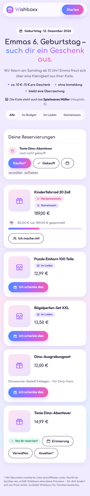
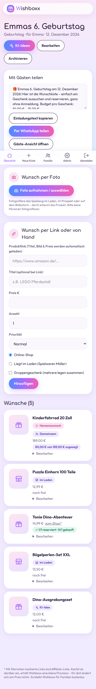
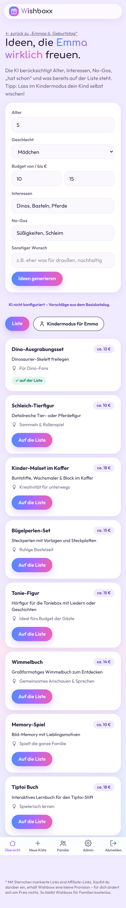
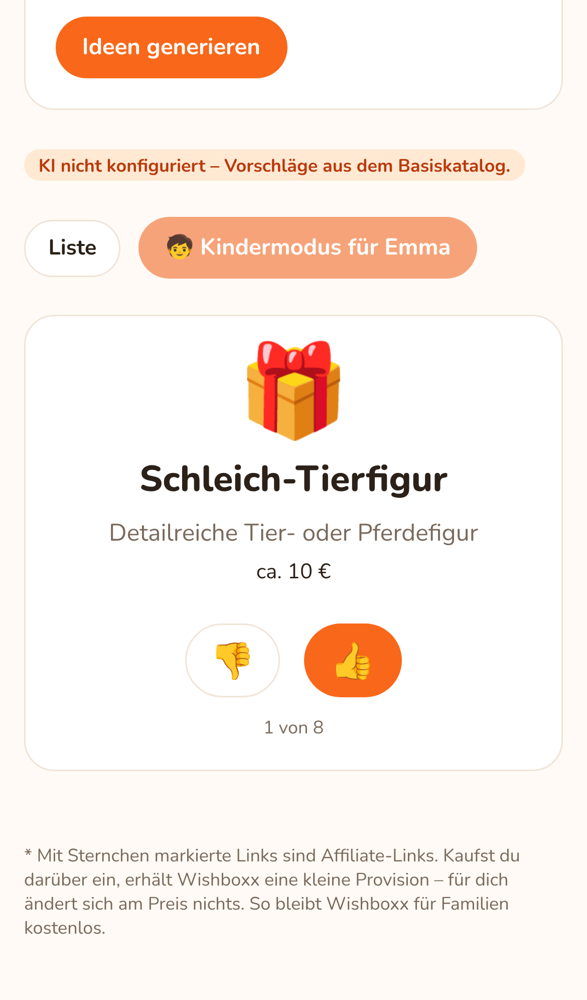

# 🎁 Wishboxx – Alle Wünsche. Alle Feste. Kopf frei.

Wunschlisten-App für Familien mit Kindern: Das Geburtstagskind „packt“ seine Kiste, Gäste suchen
sich per Link ein Geschenk aus und reservieren es – ohne Account. Dazu KI-Geschenkideen, die nach
Alter, Geschlecht, Interessen und No-Gos eingegrenzt sind, Gruppengeschenke, Danke-Liste und
automatische Affiliate-Monetarisierung.

➡️ Warum es Wishboxx gibt und was es anders macht als Wishbob & Co.: [docs/MARKTANALYSE.md](docs/MARKTANALYSE.md)

## Screenshots

| Gäste-Ansicht | Kiste verwalten | KI-Ideen | Kindermodus |
|---|---|---|---|
|  |  |  |  |

## Als App aufs Handy (PWA)

Wishboxx ist eine installierbare Web-App:
- **iPhone:** in Safari öffnen → Teilen ⬆️ → „Zum Home-Bildschirm“
- **Android:** in Chrome öffnen → „App installieren“ (die App zeigt auch selbst einen Knopf dafür)

Danach startet Wishboxx mit eigenem Icon, ohne Browserleiste und mit Tab-Leiste unten. Auf Android erscheint
Wishboxx zusätzlich im **„Teilen“-Menü** anderer Apps (Amazon, Shop-Apps, Browser): Produkt teilen →
Kiste wählen → fertig. Ohne Netz zeigt die App eine Offline-Seite statt einer Fehlermeldung.

Gäste brauchen weiterhin **keine** App – sie öffnen einfach den geteilten Link.

## In 60 Sekunden zur ersten Boxx

1. **„Boxx packen“** – kein Konto nötig
2. Drei Fragen: *Für wen?* · *Was wird gefeiert?* (mit Budget) · *Was mag das Kind?*
3. Die KI packt sofort passende Ideen ein – mit ✕ aussortieren, über „Teilen“ per WhatsApp verschicken
   (mit Vorschaubild: Name, Anlass, Datum)
4. Boxx sichern per **E-Mail-Link** – ohne Passwort

Neue Wünsche kommen über **ein einziges Feld**: Link einfügen, Stichwort tippen („Lego Pferd“) oder Foto machen.

## Feier & Benachrichtigungen

- **Zusagen zur Feier:** Gäste antworten über denselben Link mit „Wir kommen“ (Anzahl Kinder) oder „Leider nicht“ –
  optional **„Wir schenken etwas anderes“**, ohne zu sagen was. Uhrzeit und Ort stehen in der Einladung.
- **Gästeliste:** Eingeladene eintragen (ein Name pro Zeile) → sehen, wer noch nicht geantwortet hat, Erinnerung per WhatsApp
- **Push-Nachrichten für die Inhaberin** (installierte App, auf dem iPhone ab Home-Bildschirm): sofort bei neuen
  Reservierungen und Zusagen (Überraschungsmodus wird respektiert) und eine Erinnerung 14, 7 und 2 Tage vor dem Fest
  mit dem Stand. Ohne Push-Abo kommt die Erinnerung per E-Mail. Die Push-Schlüssel erzeugt die App selbst.

## Wunsch-Gedächtnis pro Kind

- **Merkzettel:** Bei jedem Wunsch „Fortsetzung merken“ (schlägt z.B. „Band 2“ vor) oder freie Ideen im Kinderprofil
- **„Nächstes Jahr wieder packen“** an jeder vergangenen oder archivierten Boxx: neue Boxx mit Datum +1 Jahr und
  Alter +1, offene Wünsche und Merkzettel sind dabei, die KI bevorzugt Fortsetzungen zu Geschenktem
- Geschenktes landet automatisch in „hat schon“ und wird nie wieder vorgeschlagen
- Der Schnellstart erkennt vorhandene Kinder und übernimmt Profil und Merkzettel

## Features

**Für Eltern**
- Mehrere Kinder-/Personenprofile (Alter, Interessen, No-Gos, „hat schon“, Größen)
- Mehrere Listen je Anlass: Geburtstag, Weihnachten, Ostern, Einschulung, Kommunion …
- 📷 Wünsche per Foto: Spielzeug im Laden/Prospekt fotografieren → KI erkennt das Produkt
- Wünsche per Produktlink (Titel/Bild/Preis werden automatisch geladen), als „liegt im Laden“ oder aus KI-Vorschlägen
- ✨ KI-Ideen (Claude) mit Leitplanken + 🧒 Kindermodus zum Wischen
- Budget-Rahmen pro Geschenk, Gruppengeschenke mit Fortschrittsbalken
- Überraschungsmodus in 3 Stufen, WhatsApp-Teilen mit fertigem Einladungstext
- Danke-Liste, „Erhaltenes → hat schon“, offene Wünsche in nächste Liste übernehmen

**Für Gäste**
- Kein Account, keine App: Link öffnen → „Ich schenke das“ → Name → fertig
- Filter „passend zum Budget“, eigene Reservierungen stornierbar
- „Gekauft ✓“-Häkchen, Kalendereintrag mit Erinnerung, E-Mail-Bestätigung mit Verwaltungs-Link
- Erinnerungs-Mails 7 und 2 Tage vor der Feier – nur an Gäste, die noch nicht „gekauft“ markiert haben

**Für den Betreiber (Admin)**
- Affiliate-Partner verwalten (Domains, `?tag=`-Parameter oder Deeplink-Vorlage mit `{url}`, Priorität)
- Automatisches Umschreiben aller Produktlinks beim Klick (`/go/:id`) inkl. Klick-Tracking
- KI-Vorschläge verlinken auf die Suche des bevorzugten Partners (`{query}`-Vorlage)
- **Neuen Shop per Beispiel-Link anlegen:** AWIN-, Tradedoubler-, Webgains-Deeplinks und Shop-Parameter
  (z.B. Amazon `tag=`) werden automatisch erkannt; unbekannte Formate schlägt die KI vor (nur IDs, die im Link stehen)
- Statistik, „Shops ohne Partner“ (mit „Partner anlegen“), Link-Tester

## Tech-Stack

Next.js 15 (App Router, Server Actions) · React 19 · TypeScript · Tailwind CSS 4 · SQLite (better-sqlite3) · Anthropic SDK (Claude)

## Schnellstart

```bash
npm install
cp .env.example .env.local   # optional ANTHROPIC_API_KEY und ADMIN_EMAIL setzen
npm run dev                  # http://localhost:3000
```

- Der **erste Nutzer, der sich per E-Mail-Link anmeldet,** wird Admin (oder der mit `ADMIN_EMAIL`).
- Anmeldung läuft per E-Mail-Link. Ohne SMTP zeigt die App den Link im Entwicklungsmodus (`npm run dev`)
  direkt an; zum Testen eines Produktions-Builds ohne Mailversand `SHOW_LOGIN_LINKS=1` setzen (nie live!).
- Unter **/admin** die Partner-ID beim Amazon-Partner eintragen und „aktiv“ setzen.
- Ohne `ANTHROPIC_API_KEY` liefert ein eingebauter Katalog regelbasierte Vorschläge.

```bash
npm test        # Unit-Tests (Affiliate-Engine, Metadaten, Katalog)
npm run lint    # TypeScript-Check
npm run build   # Produktions-Build
```

## Online stellen

Kostenlos auf einem Google-Cloud-Gratisserver mit Docker, HTTPS, Auto-Update und Backups:
**[docs/DEPLOY-GOOGLE-CLOUD.md](docs/DEPLOY-GOOGLE-CLOUD.md)** (Installationsskript: `deploy/install.sh`).

## Erinnerungen einrichten

1. SMTP-Zugang in `.env.local` eintragen (`SMTP_HOST`, `SMTP_USER`, …) – z.B. Brevo oder Postmark.
   Ohne SMTP werden Mails nur ins Server-Log geschrieben.
2. `CRON_SECRET` setzen und den Endpunkt einmal täglich aufrufen (Railway Cron, GitHub Actions, cron-job.org):
   ```bash
   curl -H "Authorization: Bearer $CRON_SECRET" https://deine-domain/api/cron/reminders
   ```
   Jede Erinnerungsstufe wird pro Reservierung höchstens einmal verschickt.

Fotos landen in `data/uploads/` (bzw. `UPLOAD_DIR`) – beim Hosting auf dauerhaften Speicher legen.

## Architektur

```
src/
  lib/
    db.ts           SQLite-Schema + Default-Partner
    auth.ts         E-Mail/Passwort (scrypt), Session-Cookies
    affiliate.ts    Partner-Matching & Link-Umschreibung (rein, getestet)
    suggestions.ts  KI-Vorschläge via Claude (structured output) + Fallback
    catalog.ts      regelbasierter Ideenkatalog
    metadata.ts     Open-Graph-Parser mit SSRF-Schutz
    vision.ts       Produkterkennung aus Fotos (Claude Vision)
    uploads.ts      Foto-Speicherung, Typprüfung per Magic Bytes
    reminders.ts    Erinnerungs-Stufen & Kalenderdatei (rein, getestet)
    mailer.ts       SMTP-Versand (Fallback: Log)
    repo.ts         Datenzugriff & Domain-Logik
  app/
    actions.ts      alle Server Actions
    dashboard, recipients, lists/[id], lists/[id]/ideas   Eltern-Bereich
    k/[token]       öffentliche Gäste-Ansicht
    r/[token]       Reservierung verwalten (Link aus E-Mail), /ics Kalenderdatei
    api/cron/reminders  täglicher Erinnerungslauf
    go/[itemId]     Affiliate-Redirect
    admin           Betreiber-Bereich
```

## Datenschutz

Fotos werden vor dem Upload im Browser verkleinert und als neues JPEG gespeichert – dabei gehen
EXIF-/GPS-Daten verloren. An die KI werden nur Alter, Geschlecht, Interessen, No-Gos, „hat schon“ und Listentitel
übermittelt – nie Namen oder Geburtsdaten. Gäste-Listen sind per `noindex` vor Suchmaschinen
geschützt; der Link kann jederzeit zurückgesetzt werden.
